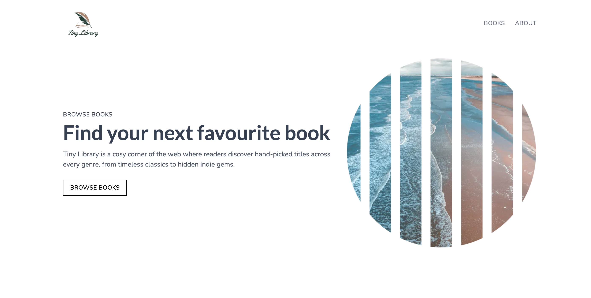

# Tiny Library

A small, curated book catalogue built with Next.js as my solo project for the Next.js section of the Scrimba Full Stack course.

**Live demo:** https://tiny-library-orcin.vercel.app/



## Features

- Browse a catalogue of 52 books in a responsive grid
- Filter by category, with a sidebar on desktop and a scrolling bar on mobile
- Search by title or author, with live suggestions as you type
- Keyboard navigation for suggestions (arrow keys, Enter, Escape)
- Active link highlighting in the navbar and category menu
- Book detail pages with a custom 404 for missing books
- Dynamic page titles for each book and category
- Responsive layouts for mobile and desktop

## Tech stack

- [Next.js 15](https://nextjs.org) (App Router)
- TypeScript
- Tailwind CSS v4
- [Lucide](https://lucide.dev) icons
- Deployed on [Vercel](https://vercel.com)

## Running it locally

```bash
npm install
npm run dev
```

Then open http://localhost:3000.

## Decisions and what I learned

**Only the link and search components are client components.** Pages, layouts, and most components are server components, which fetch their data with `await` and send finished HTML to the browser. The only parts that need the browser are the ones that react to the user: the navbar and category links (which read the current URL with `usePathname` to highlight the active page) and the search box (which tracks typing with `useState`). Keeping those small and separate means the layouts around them can stay on the server. The books layout has to, since it awaits the category data.

**The search lives in the URL.** Submitting a search navigates to `/books?query=...`, and the books page reads that query on the server and filters the results. Because the search is in the URL, refreshing keeps the results, the back button works, and a search can be shared as a link. The live suggestions are separate: they always search the full catalogue, not just the current results, so a search with no matches doesn't leave the suggestions empty.

**The autocomplete was the hardest part.** It looked simple, but making it feel natural meant handling many different events and keeping three pieces of state in sync: the text, whether the dropdown is open, and which suggestion is highlighted. Typing, focusing, blurring, arrow keys, Enter, and Escape each have to update that state together. The trickiest bug was that clicking a suggestion blurred the input first, which closed the dropdown before the click could register. Testing it with my own habits (reaching for the arrow keys) is what showed me which behaviors were missing.

## Credits

Built as a solo project for the [Scrimba](https://scrimba.com) Full Stack course. The design comes from the course's Figma file, and the book data is placeholder content provided by the course.